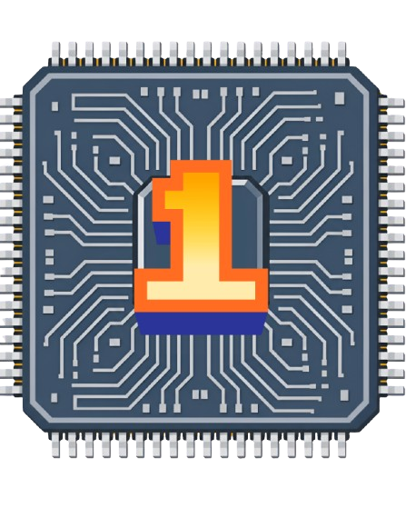

# PROGRESSION UP — Sistema de Missões & Produtividade Gamificada

<p align="center">
  
</p>

<p align="center">
  <strong>Transforme sua rotina em uma jornada épica. Conclua tarefas, ganhe XP, evolua seu agente e jogue com amigos.</strong>
</p>

<p align="center">
  <a href="https://progressionup.vercel.app/"><strong>Jogue agora online: https://progressionup.vercel.app/</strong></a>
</p>

<p align="center">
  
  
  
  
</p>

---

## Acesso Rápido

- **Deploy em Produção:** [https://progressionup.vercel.app/](https://progressionup.vercel.app/)

---

## Visão & Proposta

Inspirado na estética **Cyberpunk** e no conceito de evolução contínua (*Solo Leveling*), o **Progression Up** é uma plataforma que transforma a gestão de hábitos e metas diárias em uma experiência imersiva de RPG.

Em vez de listas de afazeres monótonas, cada compromisso real se torna uma **missão** ranqueada (do Rank F ao Rank S). Concluir suas atividades concede **XP**, **fichas de incursão** e **atributos**, permitindo ao usuário subir de nível, customizar seu agente em um armário 3D interativo e participar de incursões cooperativas e minigames em pixel art.

---

## Principais Funcionalidades

### 1. Sistema de Missões & Gamificação Pessoal
- **Categorias de Habilidades:** Missões divididas por áreas da vida (Físico, Mente, Foco, Social, etc.).
- **Graus de Dificuldade:** Ranks F, E, D, C, B, A e S com recompensas proporcionais de XP e fichas.
- **Sequência Diária (Streak):** Bonificações para quem mantém a disciplina diária contínua.
- **Histórico & Logs:** Registro detalhado com metas alcançadas e marcos históricos.

### 2. Armário & Editor de Avatar 3D
- **Pedestal Holográfico:** Avatar montado sobre um pedestal giratório 3D com efeitos de luz cyberpunk.
- **Customização Total:** Cabelos, tons de pele, roupas, expressões faciais, calças, acessórios e armas.
- **Classes & Bônus de Atributos:** Especializações que conferem bônus específicos em tarefas e minigames.
- **Controles Intuitivos:** Carrossel em arco navegável por toque, roda do mouse ou atalhos de teclado ($\leftarrow \rightarrow \uparrow \downarrow$).

### 3. Minigame Plataforma: "Incursão na Cidade"
- **Ação Beat 'em Up 2D em Canvas:** Use suas fichas ganhas nas tarefas diárias para entrar em incursões táticas.
- **Combate & Habilidades:** Ataques corpo a corpo, pulo duplo, descida rápida em plataformas vazadas e habilidades especiais com recarga.
- **Inimigos & Chefões:** Drones de patrulha, ciborgues, armadilhas urbanas e chefões com padrões de ataque únicos.
- **Radar Tático em Tempo Real:** Varredura tática estilo sonar que detecta a aproximação de inimigos e chefes ao redor.

### 4. Experiência Mobile & PWA (Console Retrô)
- **Controles Virtuais Estilo Console:** Joystick analógico suave, botões de ação ergonômicos e atalhos START/SELECT.
- **Modo Retrato & Paisagem:** Visualização adaptada com proporção 16:9 dinâmica e modo tela cheia com trava de orientação.
- **Instalação como Aplicativo Nativo (PWA):** Suporte offline-first via Service Worker, manifesto web e ícones adaptativos para Android, iOS e Desktop.

### 5. Comunidade, Esquadrões & Multiplayer Co-op
- **Sistema de Amizades & Presença:** Status em tempo real (*online*, *em missão*, *ausente*).
- **Esquadrões (Guildas):** Crie grupos, recrute membros e colabore em **Metas Semanais Compartilhadas**.
- **Chat em Tempo Real:** Conversas privadas (DMs) e canais de esquadrão com envio de anexos criptografados e moderação de conteúdo.
- **Salas Co-op:** Crie ou entre em salas com código de convite para jogar incursões lado a lado.
- **Rankings Globais & Sazonais:** Tabelas de classificação por XP, Sequência, Missões Concluídas, Distância e Esquadrões, com encerramento de temporadas e distribuição de prêmios.

---

## Tecnologias Utilizadas

- **Front-end:** HTML5 semântico, CSS3 Moderno (Custom Properties, Flexbox, Grid, Animações 3D), JavaScript puro (ES6+ modular, sem frameworks pesados).
- **Engine do Jogo:** HTML5 Canvas 2D com física de plataforma, partículas e áudio sintetizado via Web Audio API.
- **PWA:** Service Worker com estratégia *Network-First* / *Stale-While-Revalidate* e Web App Manifest.
- **Backend & Database:** [Supabase](https://supabase.com/) (PostgreSQL 15+, Row Level Security, Realtime Channels, Storage, Edge Functions Deno e `pg_cron`).
- **Autenticação:** Supabase Auth com suporte a E-mail/Senha e OAuth 2.0 (Google, GitHub, Discord) com fluxo seguro PKCE.

---

## Como Executar o Projeto Localmente

O projeto foi construído em arquitetura estática e modular, não exigindo etapas de compilação pesadas.

### 1. Clonar o repositório
```bash
git clone https://github.com/kkvieira/progressionup.git
cd progressionup
```

### 2. Configurar as variáveis do Supabase
Copie o arquivo de exemplo e insira suas credenciais do projeto Supabase:
```bash
cp .env.example .env
```
Ou edite diretamente o arquivo [`js/env.js`](file:///c:/Users/kaiky/OneDrive/%C3%81rea%20de%20Trabalho/progression%20up/js/env.js):
```javascript
window.__ENV__ = {
  SUPABASE_URL: "https://SEU-PROJETO.supabase.co",
  SUPABASE_ANON_KEY: "sua-chave-anon-aqui"
};
```

### 3. Iniciar um servidor local
Você pode usar qualquer servidor HTTP estático:

- **Via Python:**
  ```bash
  python -m http.server 5500
  ```
- **Via Node (npx serve):**
  ```bash
  npx serve .
  ```
- **Via VS Code:**
  Abra com a extensão [Live Server](https://marketplace.visualstudio.com/items?itemName=ritwickdey.LiveServer) na porta `5500`.

Acesse no navegador: `http://localhost:5500`

---

## Configuração do Banco de Dados (Supabase)

O diretório [`supabase/`](file:///c:/Users/kaiky/OneDrive/%C3%81rea%20de%20Trabalho/progression%20up/supabase/) contém toda a infraestrutura pronta:

| Arquivo / Pasta | Finalidade |
| --- | --- |
| `migrations/001_initial_schema.sql` | Perfis, tarefas diárias, histórico e inventário |
| `migrations/002_social_multiplayer_schema.sql` | Amigos, grupos, conversas, salas co-op e rankings |
| `migrations/003_social_rls_policies.sql` | Políticas estritas de Row Level Security (RLS) |
| `migrations/004_social_rpcs_and_triggers.sql` | Funções de banco (RPCs) e triggers de progresso |
| `migrations/005_realtime_storage_cron.sql` | Publicações em tempo real, buckets de armazenamento e rotinas cron |
| `migrations/006_revoke_internal_functions.sql` | Restrição de segurança e fechamento de funções internas |
| `functions/` | Edge Functions de moderação de chat e notificações automáticas |

> **Para o guia completo de deploy das migrations, RLS e Edge Functions, consulte o arquivo [SUPABASE_SETUP.md](SUPABASE_SETUP.md).**

---

## Estrutura de Pastas

```text
progressionup/
├── css/
│   ├── style.css         # Estilos globais, painéis HUD, abas e responsividade
│   ├── character.css     # Estilização do editor de personagem e armário 3D
│   └── game.css          # Estilos do minigame e controles táteis de console
├── img/                  # Ícones PWA, logos, favicons e texturas
├── js/
│   ├── env.js            # Injeção de variáveis de ambiente
│   ├── supabase.js       # Cliente singleton Supabase e métodos base de Auth
│   ├── character.js      # Lógica do avatar, cosméticos e animação do armário
│   ├── game.js           # Mecânicas do jogo de plataforma, física e radar
│   ├── script.js         # Gerenciamento de estado, HUD, tarefas e rotas
│   ├── pwa.js            # Registro do Service Worker e prompt de instalação
│   └── services/         # Serviços sociais (amigos, chat, grupos, rankings, coop)
├── supabase/             # Migrações SQL, testes de RLS e Edge Functions
├── index.html            # Estrutura principal da aplicação
├── manifest.webmanifest  # Configuração PWA para celulares e desktops
├── sw.js                 # Service Worker (estratégias de cache offline)
├── SUPABASE_SETUP.md     # Documentação da infraestrutura de backend
└── README.md             # Documentação principal do projeto
```

---

## Licença

Distribuído sob a licença **MIT**. Consulte `LICENSE` para mais detalhes.

---

<p align="center">
  Desenvolvido com foco e dedicação. <i>Evolua a cada missão!</i>
</p>
